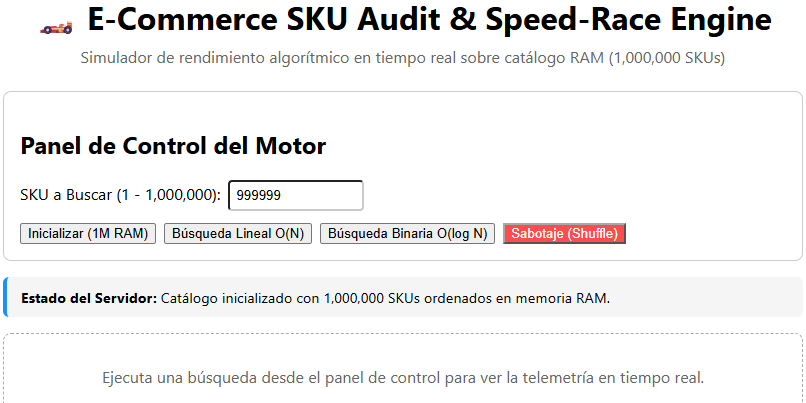
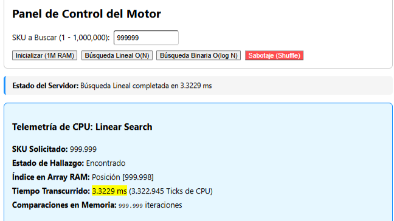
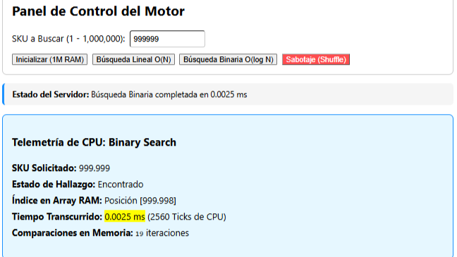
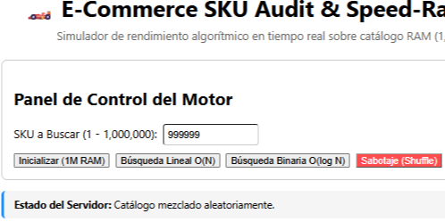
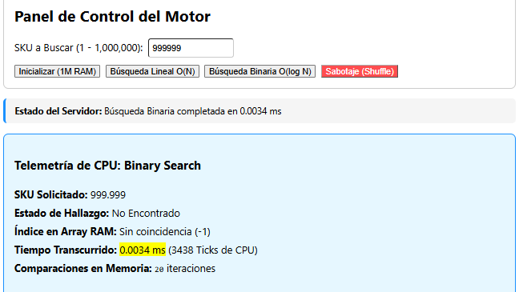
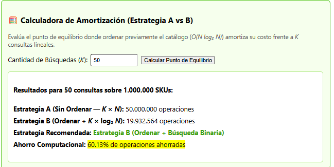

# 🚀 E-Commerce SKU High-Speed Search & Algorithmic Audit Engine

[](https://github.com/giobok10/ecommerce-speedrace-engine)
[](https://dotnet.microsoft.com/)
[](https://react.dev/)
[](https://www.docker.com/)

Un motor de auditoría y simulador interactivo de alta velocidad diseñado para evaluar y contrastar el rendimiento asintótico de algoritmos de búsqueda sobre un catálogo en memoria de **1,000,000 de SKUs** bajo el Modelo de Cómputo RAM.

---

## 📌 Características Principales

- **Gestión Contigua en Memoria RAM:** Reserva e indexación directa de 1,000,000 de registros enteros (O(1) acceso por índice).
- **Benchmark en Tiempo Real:** Comparativa de rendimiento entre Búsqueda Lineal O(n) y Búsqueda Binaria O(log n), midiendo ticks del reloj de alta resolución y milisegundos de CPU.
- **Modo Sabotaje (Fisher-Yates Shuffle):** Mecanismo de corrupción de índices en O(n) para demostrar la ruptura de la precondición de monotonía estricta y evidenciar la generación empírica de **falsos negativos (-1)**.
- **Calculadora de Amortización (Break-Even Point):** Análisis matemático interactivo del umbral k ≈ log₂(n) para determinar cuándo la inversión de ordenar el catálogo O(n log n) queda amortizada frente a k consultas lineales.
- **Arquitectura Dockerizada:** Entorno de producción multi-contenedor con .NET 8 Web API y Frontend estático servido mediante Nginx.

---

## 🧪 Resultados Empíricos (N = 1,000,000)

| Escenario de Auditoría | Búsqueda Lineal O(n) | Búsqueda Binaria O(log n) | Aceleración / Estado |
|:---|:---|:---|:---|
| **Peor Caso: Elemento Final (`999,999`)** | ~3.32 ms (~3,322,945 Ticks, 999,999 iteraciones) | ~0.0025 ms (~2,560 Ticks, 19 iteraciones) | **> 1,300x más rápido** |
| **Arreglo Mezclado (Modo Sabotaje)** | Recorre N elementos correctamente | Retorna `Index: -1` (**Falso Negativo**) | *Falla Lógica Confirmada* |
| **Amortización (K = 50 consultas)** | 50,000,000 operaciones | 19,932,564 operaciones (Ahorro del 60.13%) | **Estrategia B Recomendada** |

---

## 📸 Evidencia Visual del Sistema

| Inicialización de 1M SKUs | Benchmark Búsqueda Lineal |
|:---:|:---:|
|  |  |

| Benchmark Búsqueda Binaria | Aplicación de Sabotaje (Shuffle) |
|:---:|:---:|
|  |  |

| Falso Negativo por Desorden | Análisis de Amortización (K = 50) |
|:---:|:---:|
|  |  |

---

## 🛠️ Guía de Ejecución Local

### 1. Prerrequisitos

- .NET 8 SDK
- Node.js y pnpm
- Docker y Docker Compose (opcional para producción)

### 2. Ejecución Manual

#### Backend (.NET 8)

```bash
cd backend/SpeedRaceEngine.Api
dotnet run
```

*Swagger UI disponible en: [http://localhost:5121/swagger](http://localhost:5121/swagger)*

#### Frontend (React + Vite)

```bash
cd frontend
pnpm install
pnpm run dev
```

*Dashboard disponible en: [http://localhost:5173](http://localhost:5173)*

### 3. Ejecución con Docker Compose (Producción)

```bash
docker compose up --build -d
```

*Acceso unificado en: [http://localhost](http://localhost)*

---
